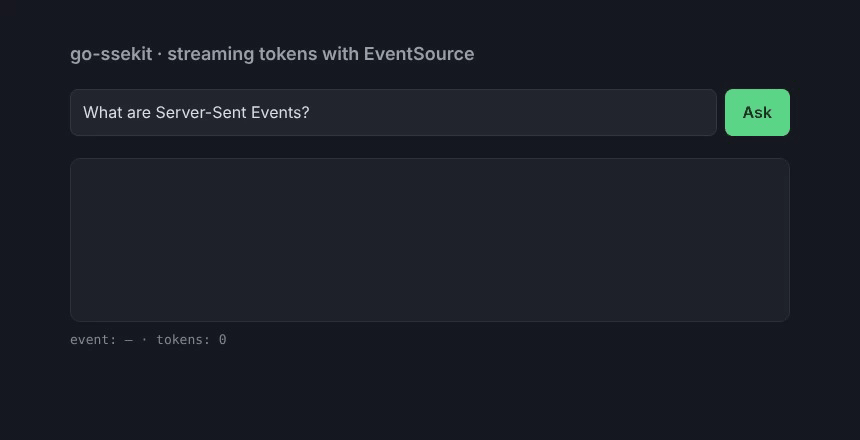

# go-sse

[](https://github.com/shani8615/go-sse/actions/workflows/ci.yml)
[](https://pkg.go.dev/github.com/shani8615/go-sse)
[](https://goreportcard.com/report/github.com/shani8615/go-sse)
[](https://github.com/shani8615/go-sse/releases)
[](go.mod)
[](LICENSE)

**Server-Sent Events for Go, done right.** Use it to stream LLM tokens, job progress, notifications and live dashboards over plain HTTP. Works with `net/http` and anything built on it, with no dependencies outside the standard library.



<sub>Try it: `go run ./examples/llm-stream`, then open http://localhost:8080</sub>

```bash
go get github.com/shani8615/go-sse
```

| | |
|---|---|
| `Upgrade` → `*Stream` | correct headers (incl. `X-Accel-Buffering: no` for nginx), flushing that works through wrapped writers, multi-line data, write timeouts for stalled clients, keep-alive comments |
| `Broker` | fan-out to many clients, a **replay buffer** so reconnecting clients get what they missed (`Last-Event-ID`), slow clients disconnected instead of blocking everyone |
| `Reader` | parser that follows the WHATWG spec: CR/LF/CRLF, BOM, comments, `retry`, persistent IDs |
| `Client` | `Subscribe` with automatic reconnect, backoff, jitter and `Last-Event-ID`; `Do` for one-shot POST streams (LLM APIs) |

## Stream LLM tokens to a browser

```go
http.HandleFunc("GET /chat", func(w http.ResponseWriter, r *http.Request) {
    s, err := sse.Upgrade(w, r, sse.StreamOptions{WriteTimeout: 10 * time.Second})
    if err != nil {
        http.Error(w, err.Error(), http.StatusInternalServerError)
        return
    }
    for tok := range llm.Stream(s.Context(), r.URL.Query().Get("q")) { // stops when the client leaves
        if err := s.SendJSON("token", tok); err != nil {
            return
        }
    }
    _ = s.Send(sse.Event{Event: "done", Data: "{}"})
})
```

```js
const es = new EventSource("/chat?q=hello");
es.addEventListener("token", e => output.textContent += JSON.parse(e.data).text);
es.addEventListener("done", () => es.close());
```

## Broadcast with resume

```go
broker := sse.NewBroker(sse.BrokerOptions{Replay: 500})
http.Handle("GET /events", broker) // handles Last-Event-ID, keep-alives, slow clients

broker.Publish(sse.Event{Event: "order.updated", Data: `{"id":"o-1","status":"shipped"}`})
```

Event IDs are assigned automatically. When a browser reconnects, it sends `Last-Event-ID` and receives every event it missed that's still in the replay buffer.

## Consume a stream in Go

```go
c := &sse.Client{Header: http.Header{"Authorization": {"Bearer " + token}}}

err := c.Subscribe(ctx, "https://api.example.com/events", func(e sse.Event) error {
    log.Printf("%s %s", e.Event, e.Data)
    return nil // return sse.ErrStop to finish
})
```

Reconnects follow the spec: the server's `retry` hint, backoff with jitter, and `Last-Event-ID`. A `204` stops reconnecting. A `4xx` returns `*sse.StatusError`.

### OpenAI-style streaming (POST)

```go
req, _ := http.NewRequestWithContext(ctx, "POST", url+"/chat/completions", body)
req.Header.Set("Authorization", "Bearer "+key)
err := (&sse.Client{}).Do(req, func(e sse.Event) error {
    if e.Data == "[DONE]" {
        return sse.ErrStop
    }
    var chunk Chunk
    if err := json.Unmarshal([]byte(e.Data), &chunk); err != nil {
        return err
    }
    fmt.Print(chunk.Choices[0].Delta.Content)
    return nil
})
```

## Production notes

- **Proxies:** nginx buffers responses by default. The `X-Accel-Buffering: no` header turns buffering off per response. Keep-alive comments stop idle-timeout disconnects on load balancers.
- **HTTP/1.1** allows only ~6 connections per domain in browsers, so serve SSE over HTTP/2 when you can.
- **Server timeouts:** `http.Server.WriteTimeout` kills long streams. Leave it at 0 and use `StreamOptions.WriteTimeout` instead, which applies per write.

## Why go-sse?

There are good SSE libraries for Go already, including [tmaxmax/go-sse](https://github.com/tmaxmax/go-sse) (a separate project with the same name) and [r3labs/sse](https://github.com/r3labs/sse). This one focuses on a small API and on LLM streaming:

| | this go-sse | tmaxmax/go-sse | r3labs/sse |
|---|---|---|---|
| Dependencies | standard library only | uses `cenkalti/backoff` | uses `cenkalti/backoff` |
| Server writer + fan-out broker | ✓ | ✓ with pluggable providers | ✓ |
| Replay for reconnecting clients | ✓ `Last-Event-ID` header or `?lastEventId=` | ✓ replayer interface | ✓ event log |
| Slow subscribers dropped (not blocking others) | ✓ | — | — |
| One-shot POST streams (LLM APIs) | ✓ `Client.Do` | ✓ `sse.Read` iterator | — |
| Per-write timeouts for stalled clients | ✓ | — | — |

<sub>— = not documented in that project's README/docs at the time of writing.</sub>

**Pick this go-sse** for a compact, dependency-free building block. **Pick tmaxmax/go-sse** if you need its pluggable providers (e.g. backing the broker with an external pub/sub).

## License

MIT
